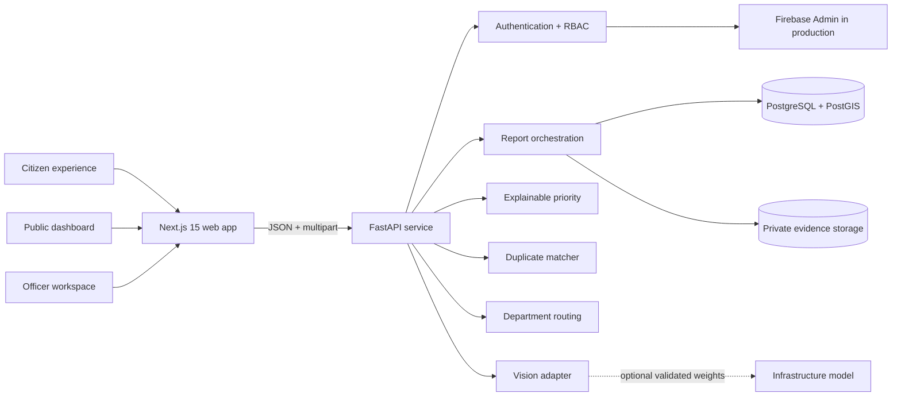

<div align="center">

# CivicOS AI

### Public infrastructure intelligence people can see, understand, and trust.

A multilingual, voice-enabled civic reporting platform that turns citizen evidence into explainable incidents, accountable workflows, and privacy-safe public insight.


[Quick start](#quick-start) · [Features](#what-it-does) · [Architecture](#architecture) · [API](#api-surface) · [Documentation](#documentation)

</div>

---

## Why CivicOS AI

Civic infrastructure reports are often isolated across phone calls, forms, and departments. CivicOS AI creates one accountable record from the first citizen report to the final repair:

- Citizens can report an issue with a photo, location, typed description, or voice dictation.
- Related reports can be grouped without deleting individual evidence or citizen voices.
- Priority is deterministic and explainable; officers remain responsible for final triage.
- Every status change is preserved in a timeline.
- The public sees real stored metrics and approximate map locations—not personal information.

The repository is an executable, production-minded MVP. It is explicit about demo authentication, external AI dependencies, synthetic seed data, and the limits of automated recommendations.

## What it does

| Experience | Capability |
|---|---|
| Citizen reporting | Photo upload, category, multilingual description, browser voice input, GPS or manual coordinates, anonymous public display |
| Report tracking | Private tracking ID, current status, priority, category, and immutable progress timeline |
| Officer workspace | Role-protected, priority-ranked incident queue with search and priority filters |
| Public transparency | Stored metrics, category distribution, approximate incident map, and privacy-safe data notes |
| Explainable triage | Deterministic 0–100 priority score with contributing factors and human-review requirements |
| Duplicate detection | Category, distance, recency, and text-overlap matching while preserving each source report |
| Department routing | Capability-based recommendation with an explicit confidence and explanation |
| Evidence analysis | Image quality checks and an optional adapter for specialized infrastructure vision weights |

## Premium, inclusive interface

The web experience is designed as a complete system rather than a collection of screens:

- Light and dark themes are tuned independently, respect the first system preference, and persist on the device.
- English, हिन्दी, and తెలుగు switch instantly across navigation and primary workflows.
- Voice dictation uses the browser Speech Recognition API; report text remains editable before submission.
- Read-aloud uses browser speech synthesis and follows the selected interface language.
- Responsive navigation, large touch targets, visible focus states, reduced-motion support, semantic status feedback, and a skip link improve accessibility.
- No remote font download is required at build time, keeping container and offline builds reliable.

> Voice recognition support is strongest in current Chromium-based browsers such as Chrome and Edge. The UI detects unsupported browsers and keeps the typed workflow fully available.

## Architecture



The API is the authorization boundary. The client never grants itself access. In production, Firebase ID tokens and server-side role claims replace the clearly marked development role header.

## Technology

| Layer | Stack |
|---|---|
| Web | Next.js 15 App Router, React 19, TypeScript, MapLibre GL, Lucide icons |
| API | FastAPI, Pydantic, SQLAlchemy, Alembic |
| Data | PostgreSQL 16, PostGIS 3.4; SQLite is supported for local smoke tests |
| Authentication | Firebase Admin in production; explicit demo-role mode in development |
| Evidence | Local volume in the demo, replaceable through the storage adapter |
| Testing | Pytest API workflow tests and a strict Next.js production build |
| Runtime | Docker Compose or local Node.js 22 and Python 3.12 |

## Quick start

### Option 1: Docker Compose

Prerequisites: Docker Desktop or Docker Engine with Compose.

```powershell
Copy-Item .env.example .env
docker compose up --build
```

Open:

- Web app: <http://localhost:3000>
- Interactive API docs: <http://localhost:8000/docs>
- API health: <http://localhost:8000/api/v1/health>

The first API start creates the schema and adds clearly labeled synthetic records so the dashboard and map are useful immediately.

Stop the stack without deleting its database or evidence volumes:

```powershell
docker compose down
```

### Option 2: Local development

Copy the environment template first:

```powershell
Copy-Item .env.example .env
```

Start the API:

```powershell
cd apps/api
python -m venv .venv
.venv\Scripts\Activate.ps1
pip install -r requirements.txt
$env:CIVICOS_DATABASE_URL = "sqlite:///./civicos.db"
uvicorn app.main:app --reload --port 8000
```

In another terminal, start the web app:

```powershell
cd apps/web
corepack enable
pnpm install
pnpm run dev
```

For macOS or Linux, activate the virtual environment with `source .venv/bin/activate` and export the database variable with `export CIVICOS_DATABASE_URL=sqlite:///./civicos.db`.

## Environment configuration

All supported settings are documented in [.env.example](.env.example).

| Variable | Required | Purpose |
|---|---:|---|
| `CIVICOS_ENV` | Yes | `development` enables explicit demo behavior; use `production` for deployment |
| `CIVICOS_DATABASE_URL` | Yes | SQLAlchemy connection URL for PostgreSQL/PostGIS or local SQLite |
| `CIVICOS_CORS_ORIGINS` | Yes | Comma-separated web origins allowed by the API |
| `CIVICOS_UPLOAD_DIR` | Yes | Private evidence storage directory |
| `CIVICOS_MAX_UPLOAD_MB` | Yes | Server-side upload limit |
| `CIVICOS_ALLOW_DEMO_AUTH` | Development only | Allows the explicit `X-Demo-Role` header outside production |
| `FIREBASE_PROJECT_ID` | Production | Firebase project used to validate identity tokens |
| `GOOGLE_APPLICATION_CREDENTIALS` | Production | Firebase Admin service credentials path |
| `CIVICOS_YOLO_WEIGHTS` | Optional | Validated, specialized infrastructure model weights |
| `OPENAI_API_KEY` | Optional/future adapter | Reserved for grounded structured multilingual extraction |
| `NEXT_PUBLIC_API_URL` | Web | Browser-visible base URL of the API |

Never commit `.env`, Firebase credentials, evidence uploads, or model secrets.

## Primary user journeys

### Report an issue

1. Add an optional JPEG, PNG, or WebP photo.
2. Select a category and type or dictate the description in English, Hindi, or Telugu.
3. Capture GPS or enter coordinates manually.
4. Choose whether the public portal may show the report anonymously.
5. Submit and keep the generated tracking ID.

### Track a report

Enter the private `CVR-...` tracking ID to see the grouped incident, current status, priority, and documented history.

### Review the public portal

The dashboard reads stored database records. It publishes aggregate counts and rounded coordinates only. Citizen identity, private evidence, and precise coordinates are excluded.

### Work the officer queue

The demo uses an explicit municipal-officer role header. Production mode rejects this shortcut and requires a verified bearer token with an authorized role claim.

## API surface

| Method | Endpoint | Access | Purpose |
|---|---|---|---|
| `GET` | `/api/v1/health` | Public | Service health |
| `POST` | `/api/v1/reports` | Citizen+ | Submit multipart report evidence |
| `GET` | `/api/v1/reports/{tracking_id}` | Tracking ID holder | Read a privacy-safe timeline |
| `GET` | `/api/v1/officer/incidents` | Officer/admin | Read the ranked incident queue |
| `PATCH` | `/api/v1/officer/incidents/{public_id}/status` | Officer/admin | Record an audited workflow transition |
| `GET` | `/api/v1/public/metrics` | Public | Read aggregate metrics and rounded map points |

Full request and response schemas are available through Swagger UI at `/docs`.

## Project structure

```text
civicos-ai/
├── apps/
│   ├── api/
│   │   ├── app/
│   │   │   ├── api/          # HTTP routes
│   │   │   ├── core/         # config, database, authentication
│   │   │   └── services/     # priority, routing, duplicate, vision, storage
│   │   ├── migrations/       # Alembic schema history
│   │   └── tests/            # API workflow and authorization tests
│   └── web/
│       ├── app/              # Next.js routes and global design system
│       ├── components/       # navigation, preferences, voice, map, dashboards
│       └── lib/              # typed API boundary
├── docs/                     # architecture, API, and demo notes
├── infra/postgres/           # PostGIS initialization
├── docker-compose.yml
└── .env.example
```

## Verification

Run the API test suite:

```powershell
cd apps/api
pytest
```

Run the strict web production build:

```powershell
cd apps/web
pnpm run build
```

Suggested manual browser checks:

1. Toggle light and dark mode, refresh, and confirm the choice persists.
2. Switch between English, हिन्दी, and తెలుగు on every route.
3. Dictate a report description in a supported browser, then edit the transcript.
4. Use the navigation speaker button to start and stop page read-aloud.
5. Test keyboard navigation, focus visibility, mobile navigation, and reduced motion.
6. Submit a report, copy its tracking ID, and load its timeline.

## Privacy, security, and responsible AI

- Uploads use an allowlist, byte cap, decoded image validation, generated filenames, and SHA-256 hashes.
- CORS is explicit and authorization checks run in API dependencies.
- Production disables demo authentication regardless of the role header.
- Sensitive workflow changes create audit records and require a reason.
- Public coordinates are rounded and public responses omit citizen identity and media.
- AI priority and routing are recommendations, never claims of verified fact.
- Missing specialized vision weights produce a structured human-review result rather than fabricated detection.

Before a public deployment, add ingress rate limiting, malware scanning, image metadata stripping, private object storage with signed access, retention enforcement, security review, and a WCAG 2.2 AA audit.

## Current limitations

- The repository does not ship specialized road-damage model weights.
- Browser speech recognition availability varies by engine, platform, and language pack.
- The duplicate matcher is lexical and distance-based; production recall needs multilingual embeddings and image similarity.
- Jurisdiction routing uses department capabilities; official ward boundaries are not bundled.
- Local evidence storage is intended for demonstrations, not public deployment.
- Municipal ticketing, notifications, offline submission queues, and calibrated forecasting remain future integrations.

## Documentation

- [Architecture and implementation](docs/ARCHITECTURE.md)
- [API, authorization, and operations](docs/API.md)
- [Demo script, pitch, limitations, and roadmap](docs/DEMO.md)

## Roadmap

- Official ward polygons and boundary-aware routing with PostGIS.
- Multilingual semantic duplicate matching and perceptual image hashes.
- Officer incident detail, merge/unmerge, before/after verification, and SLA tooling.
- Offline-first reporting and optional SMS/WhatsApp status notifications.
- Grounded structured extraction with correction capture and evaluation.
- Calibrated hotspot forecasting only after sufficient real historical data exists.

---

<div align="center">
Built for accountable public infrastructure—not automated certainty.
</div>
